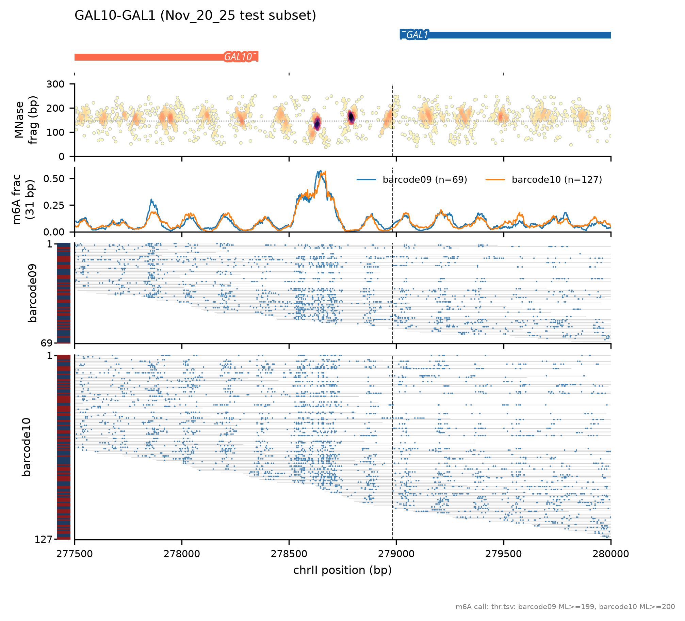
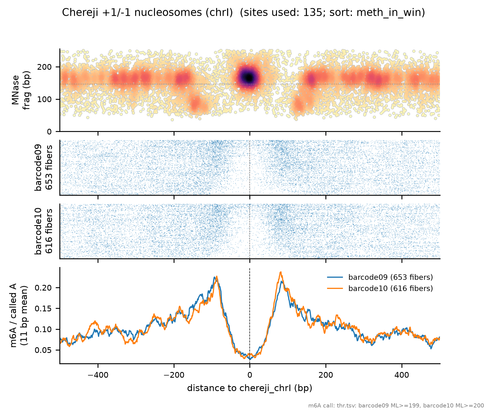
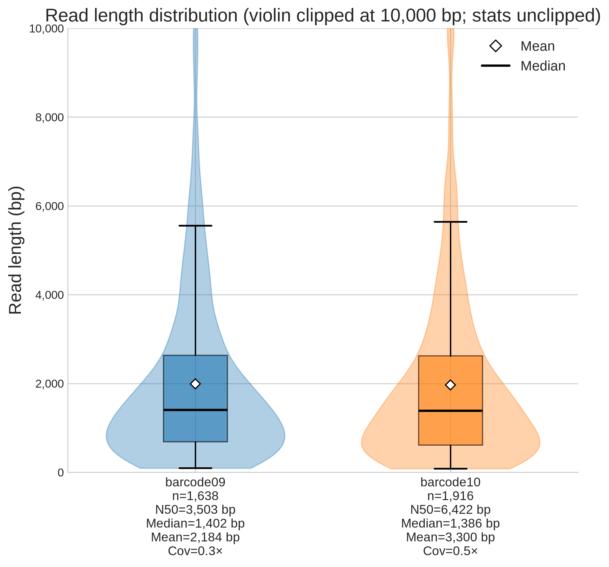
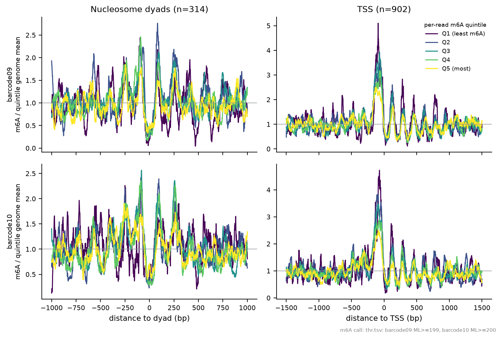

# fibernhat

Tools for **nanopore Fiber-seq (m6A)** data. Everything starts from a BAM file: plug in BAMs from any cluster or dorado version and get QC plots, single-molecule fiberplots, aggregate plots and per-read m6A-quintile metaprofiles.

- **BAM only.** MM/ML tags are read directly with pysam; there is no parquet or TSV export step.
- **One m6A call everywhere.** Each sample gets its own cutoff at the 10th percentile of call confidence (modkit `sample-probs` semantics).
- **modkit is optional.** It runs as a second engine and is tested to give identical results (pinned to modkit 0.4.4).
- **Built for AI agents.** Each capability is a skill in `.claude/skills/<name>/SKILL.md`, listed in [`CAPABILITIES.md`](CAPABILITIES.md). Open Claude Code (or any agent) in this folder and ask for what you need; [`AGENTS.md`](AGENTS.md) tells it where to look.

## Install
```bash
git clone <this repo> fibernhat && cd fibernhat
uv venv .venv && uv pip install -e ".[all]"           # or: conda env create -f environment.yml
cp config/site.example.yaml config/site.yaml          # optional: MNase BAM, modkit, dorado paths
                                                      # (the example points at the lab's Duke CS cluster paths;
                                                      #  off-cluster, delete mnase_bam or point it at your own MNase BAM)
.venv/bin/pytest -q                                   # ~2 min, includes pysam==modkit parity if modkit is found
```

## Quick start
```bash
F=.venv/bin/fibernhat
$F qc my_run/*.bam -o out/qc                                        # read length / quality / N50
$F thresholds my_run/*.bam -o out/thr.tsv                           # per-barcode m6A cutoffs (optional but
                                                                    # recommended: otherwise each command
                                                                    # re-estimates them from 20k reads/sample)
$F fiberplot --bam my_run/*.bam --gene TEA1 --thresholds out/thr.tsv -o out/fp      # or --region chrII:277500-280000 --mark 278982
$F aggregate --bam my_run/*.bam --sites dyad --thresholds out/thr.tsv -o out/agg     # also tss, abf1, reb1, tf:Reb1, file
$F quintiles --bam my_run/*.bam --thresholds out/thr.tsv -o out/quintiles            # per-read m6A-rate quintiles
```
Runtime on one Nov_20_25 barcode (97k reads, 240 MB BAM), on one CPU:
- `qc`: 16 s
- `thresholds --all-reads`: 20 s
- `quintiles` (dyad, TSS, Abf1, Reb1): 1 min

For pod5 → BAM, see [`basecall-align-dorado`](.claude/skills/basecall-align-dorado/SKILL.md).

## Example figures
`examples/make_gallery.sh` rebuilds these from `tests/data`. The test data are small subsets of the Nov_20_25 barcode09/10 runs: 30% / 15% of chrI, plus the GAL1 and TEA1 loci.

| raw fiberplot (GAL10–GAL1) | aggregate (Chereji nucleosomes, chrI) |
|---|---|
|  |  |
| **read QC** | **per-read m6A quintiles** |
|  |  |

## Tips
- Name BAM files explicitly or check your glob: `barcode0*` does not match `barcode10`. Each command prints the sample labels it found.
- Skill instructions for agents are in the hidden folder `.claude/skills/` (`ls -a`).

## Layout
See `AGENTS.md`. Reference files and where they came from are listed in [`ref/README.md`](ref/README.md).

## Citing
See `CITATION.cff`.
